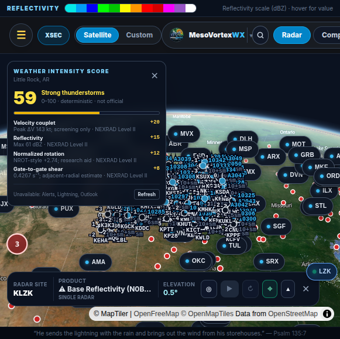
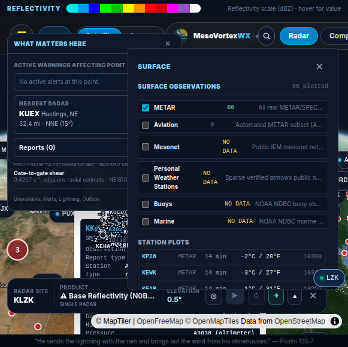
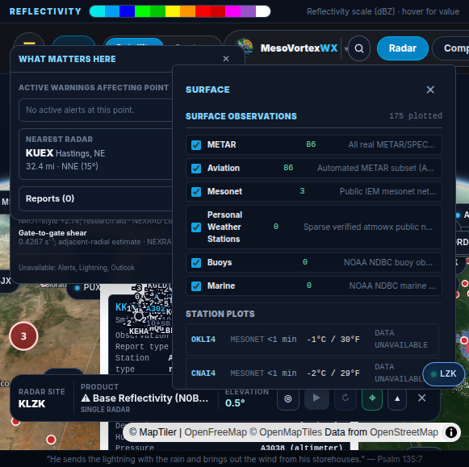

# Phase 4C: Surface Observations and Station Networks

Status: implemented and validated on `main` (commit pending at time of writing).

Phase 4C replaces generic surface map dots with a dense, source-scoped **station-model workstation** and adds independent surface observation layers. Every plotted value comes from a real upstream observation. Missing values stay `null` in the canonical model and render as `DATA UNAVAILABLE`.

## 1. Source inventory

All upstream probes were read-only and vendor-independent. Status reflects MesoVortexWX verification, not whether an upstream provider exists.

| # | Requested source | Status in 4C | Upstream / adapter | Notes |
|---|---|---|---|---|
| 1 | METAR | IMPLEMENTED | `https://aviationweather.gov/api/data/metar?format=geojson` → `/api/metar/geojson` | GeoJSON `obsTime`, `temp`/`dewp` °C, `wdir` deg, `wspd` kt, `visib` sm, `altim`/`slp` hPa, `ceil`/`clouds[].base` hundreds of ft. JSON variant supplies `elev` (m) and `metarType`. |
| 2 | SPECI | PARTIAL | Same AWC METAR feed, `metarType=SPECI` / `rawOb` prefix | No dedicated SPECI endpoint exists; classification is honest and plotted on the Aviation layer. GeoJSON returns fewer records than `format=json`. |
| 3 | ASOS | PARTIAL | `/api/asos/geojson` | Strict subset of genuine METAR reports carrying `AUTO`/`AO1`/`AO2` remarks. Remarks cannot distinguish every ASOS/AWOS site, so this is a *subset view*, never an independent ASOS feed. |
| 4 | AWOS | UNAVAILABLE | — | `DATA UNAVAILABLE`. AWC observations have no station-class field; `AUTO`/`AO1`/`AO2` are not a reliable AWOS classifier. IEM `attributes.IS_AWOS` metadata exists but no AWOS layer is plotted. |
| 5 | Mesonet | PARTIAL | `https://mesonet.agron.iastate.edu/api/1/currents.geojson?network=...` → `/api/surface/mesonet` | Network-specific. `ISUSM`, `IA_ASOS`, `IA_COOP`, `IA_DCP` verified; legacy `IOWA`, `OK_MESONET`, `KS_MESONET` return zero records and are not used. Default `ISUSM` is sparse. |
| 6 | Personal Weather Stations | PARTIAL | `https://atmowx.net/xrpc/net.atmowx.queryStations` → `/api/surface/pws` | Keyless public AT Protocol feed, but sparse (5 stations at probe time; 4 inside the verified bbox). Not a global PWS aggregator. |
| 7 | Weather Underground | UNAVAILABLE | — | `DATA UNAVAILABLE`. Vendor API terms/key required; no verified keyless feed. |
| 8 | Tempest | UNAVAILABLE | — | `DATA UNAVAILABLE`. WeatherFlow REST token required; remote multi-station use restricted. |
| 9 | Davis | UNAVAILABLE | — | `DATA UNAVAILABLE`. WeatherLink API needs user/pass/token; WeatherLink Live is LAN-only. |
| 10 | COOP | UNAVAILABLE (realtime) | `https://mesonet.agron.iastate.edu/api/1/currents.json?network=IA_COOP` | Verified IEM COOP access is once-daily climate data, not realtime surface plots. No COOP layer is plotted. |
| 11 | Buoy | IMPLEMENTED | `https://www.ndbc.noaa.gov/data/latest_obs/latest_obs.txt` → `/api/surface/buoy` | Plain-text latest observations; coordinates come from the NDBC station directory header (`STN`, `LAT`, `LON`). Only five-digit NDBC buoy IDs. Wind m/s → kt; `MM` stays missing. |
| 12 | Marine | PARTIAL | Same NDBC `latest_obs.txt` → `/api/surface/marine` | Non-buoy NDBC marine stations. Ship observations and broader marine networks are not claimed. |

Optional fields:

- **Visibility / pressure tendency / sea-level pressure** are shown only where reported. Pressure tendency is NDBC `PTDY` only; it is never inferred for METAR/IEM/PWS.
- Derived relative humidity is explicitly labeled `87% (derived)` and computed only from reported temperature and dew point.

## 2. Supported station networks (plotted today)

- **METAR + SPECI** (AviationWeather.gov) — METAR layer.
- **Aviation / ASOS subset** (`AUTO`/`AO1`/`AO2`) — Aviation layer.
- **IEM Mesonet** (`ISUSM` etc.) — Mesonet layer.
- **atmowx public PWS** — Personal Weather Stations layer.
- **NDBC buoys** — Buoys layer.
- **NDBC marine** — Marine layer.

Explicitly **not** plotted: AWOS, Weather Underground, Tempest, Davis, realtime COOP, analyzed surface fronts, ship obs.

## 3. Station model

Canvas-rendered workstation station model (`lib/surface/draw-station-model.ts`), not MapLibre circles:

- Upper-left: temperature (°C, with °F in details).
- Lower-left: dew point.
- Upper-right: pressure (altimeter `A3038` or SLP `hPa`).
- Center: total sky cover (okta) and cloud symbol.
- Wind barb: direction + speed in knots, calm/VRB handling.
- Lower-center: station identifier.
- Present weather symbol to the left: `RA SN FG TS FZRA DZ HZ FU BR SH GR GS PL IC SG UP`.
- Stale observations: amber dashed ring + amber ID.
- Hit testing returns the station under the cursor for click/tap.

### Screenshots

| Station models (default METAR layer) | Clickable station detail |
|---|---|
|  |  |

| Independent layer toggles |
|---|
|  |

Station click detail shows: full raw METAR/SPECI, observation age, report type, station type, network, elevation, wind, temperature, dew point, humidity (derived label), pressure + kind, pressure tendency, wave height/period, water temperature, visibility, ceiling, sky cover, weather conditions, source, and the raw observation string. Missing values read `DATA UNAVAILABLE`.

## 4. Data flow

```
Upstream (AWC / IEM / atmowx / NDBC)
        │  server-side fetch, no browser CORS, no keys committed
        ▼
app/api/metar|asos/geojson        app/api/surface/{mesonet,pws,buoy,marine}/route.ts
        │  normalize + unit conversion + bbox filter + _meta{ok,source,count}
        ▼
lib/metar/surface-feed.ts         lib/surface/{iem-mesonet,atmowx,ndbc}.ts
        │  feature.properties
        ▼
app/page.tsx  Promise.allSettled per layer → surfaceStations
        │  persisted independent surfaceLayers toggles + statuses/counts/errors
        ▼
lib/surface/station-model.ts  (canonical StationPlot, QC age, derived humidity, detail fields)
        │
        ├──► components/RadarMap.tsx  canvas station-model overlay (paint on move/zoom, hit test, popup)
        ├──► components/surface/SurfaceLayersPanel.tsx  dense toggles + station list + source inventory
        ├──► components/METARPanel.tsx  layer-filtered METAR list
        └──► MesoAI structured context (surfaceStations), never raw imagery
```

Future-ready contracts live in `lib/surface/types.ts`: `StationHistoryQuery`, `ObservationComparisonQuery`, `SurfaceAnalysisJob`, and `FUTURE_SURFACE_ARCHITECTURE` (station history, time-series, comparison, favorites, surface/front analysis, mesonet overlays). `StationPlot.raw` retains upstream properties for those adapters.

## 5. Files modified / added

Modified:

- `app/page.tsx` — surface layer state, multi-endpoint `Promise.allSettled` fetch, statuses/counts/errors, Surface menu, station focus, MesoAI `surfaceStations`, METARPanel filtering.
- `components/RadarMap.tsx` — removed generic surface dots; added `data-station-model-canvas` overlay, camera-follow repaint, hit testing, stale ring, compact station popup.
- `components/METARPanel.tsx` — honest ASOS-subset wording.
- `lib/metar/surface-feed.ts` — hPa conversions (`altim`, `slp`), `seaLevelPressureHpa`, SPECI `reportType`, honest source label.
- `lib/metar/surface-response.ts` — honest ASOS label.
- `lib/capabilities/observation-capabilities.ts`, `lib/capabilities/aviation-marine-capabilities.ts`, `lib/capabilities/platform-capabilities.ts` — Phase 4C status/evidence.
- `lib/data-sources.ts` — Phase 4C source inventory entries.
- `package.json` — `test:verify` includes Phase 4C guard.

Added:

- `lib/surface/types.ts`, `lib/surface/station-model.ts`, `lib/surface/draw-station-model.ts`
- `lib/surface/iem-mesonet.ts`, `lib/surface/atmowx.ts`, `lib/surface/ndbc.ts`
- `components/surface/SurfaceLayersPanel.tsx`
- `app/api/surface/mesonet/route.ts`, `app/api/surface/pws/route.ts`, `app/api/surface/buoy/route.ts`, `app/api/surface/marine/route.ts`
- `scripts/test-phase4c-surface.mjs`
- `docs/phase4c-screenshots/01-station-models.png`, `02-station-detail-popup.png`, `03-independent-layer-toggles.png`

## 6. Build results

`source ~/.nvm/nvm.sh && npm run typecheck && npm run test:verify && npm run build` — all pass.

- `tsc --noEmit`: clean.
- `test:verify`: 19 guards pass, including `PASS: Phase 4C surface station network and workstation model contracts` and `Checked 512 capability entries across 6 files`.
- `next build`: compiled successfully; routes include `/api/metar/geojson`, `/api/asos/geojson`, `/api/surface/buoy`, `/api/surface/marine`, `/api/surface/mesonet`, `/api/surface/pws`.

## 7. Verification results (production origin `http://localhost:3412`)

- Default METAR canvas painted 34,343 non-transparent pixels; Surface panel showed `86 plotted` with 14–15 min old reports.
- Station click (KK82) popup: `Observation age 15 min`, `Report type METAR`, `Station type Automated METAR report (AUTO/AO1/AO2 remarks)`, `Humidity 87% (derived)`, `Pressure A3038 (altimeter)`, raw `METAR KK82 251455Z AUTO 08012KT 10SM SCT035 BKN047 OVC095 M02/M04 A3038 RMK AO2 T10191038`, and `DATA UNAVAILABLE` for elevation, tendency, waves, water temp, and conditions.
- Independent toggles: METAR 86, Aviation 86, Mesonet 3, PWS 0, Buoys 0, Marine 0 for the current area; each layer has its own persisted checkbox and status.
- Endpoint probes: metar 96, asos 94, mesonet 7, pws 4, buoy 4, marine 17 features; invalid bbox → HTTP 400 `DATA UNAVAILABLE - invalid bbox (lat0,lon0,lat1,lon1)`.
- Browser console errors limited to one OpenFreeMap glyph 404 and the intentional invalid-bbox 400; no application exceptions.